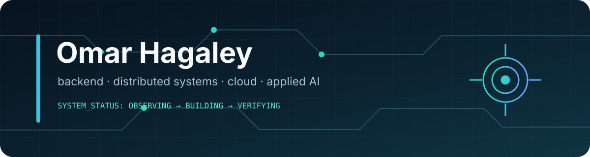

<p align="center">
  
</p>

<p align="center">
  
</p>

<p align="center">
  <a href="https://www.linkedin.com/in/omar-hagaley-b46a04293"></a>
  <a href="mailto:omarhag396@gmail.com"></a>
  <a href="https://github.com/OmarHag?tab=repositories"></a>
</p>

### `whoami`

- 🎓 University of Washington graduate in **Computer Science & Software Engineering**
- ⚙️ Interested in **backend engineering, distributed systems, cloud, and applied AI**
- 🔭 Building local-first tools that make invisible system behavior understandable
- 🧭 I care about clear boundaries, measurable performance, and honest limitations

### engineering flow

```text
observe the real system  →  model the data  →  design a narrow boundary
          ↓                                               ↓
 explain the tradeoffs   ←  verify the behavior  ←  build the interface
```

### featured systems

| | Project | What makes it technically interesting |
| :--: | --- | --- |
| `01` | **[Internet X-Ray](https://github.com/OmarHag/internet-x-ray)** | A local-first macOS connection inspector. Rust parses machine-readable `lsof` output, classifies socket scope, and sends typed snapshots across a narrow Tauri IPC boundary to React. |
| `02` | **[SuperDrop](https://github.com/OmarHag/SuperDrop)** | A cross-platform nearby-device discovery prototype using Rust-owned mDNS advertisement, browsing, expiry, and validated versioned metadata—without accounts or cloud storage. |
| `03` | **[Nextprod](https://github.com/OmarHag/Nextprod)** · [live](https://nextprod-neon.vercel.app) | An authenticated workspace with per-user tasks, interview practice, and analytics. Uses Next.js route handlers, WorkOS, parameterized PostgreSQL queries, and failure-isolated event capture. |
| `04` | **[InterviewCoach AI](https://github.com/OmarHag/bbwebsite)** · [live](https://bbwebsite-kappa.vercel.app) | Interview practice with resume ingestion, speech routes, role-specific questions, and transparent answer heuristics. Provider integrations stay behind server-side API boundaries. |
| `05` | **[ExplainMyCode](https://github.com/OmarHag/explainmycode)** | A UW capstone for structured code explanations: bounded input, language detection, schema-shaped model output, PostgreSQL persistence, bcrypt hashing, and server-side sessions. |
| `06` | **[Java Animation Platform](https://github.com/OmarHag/Omar490)** | Swing rendering and actor/behavior separation wired through Spring Boot, with authorship clearly separated from the supplied course layout library. |

### research signal

> Distributed-systems research documented a **20% reduction in processing time**. The claim is intentionally kept to the documented result; a paper or institutional artifact will be linked when it is publicly available.

### stack I use

<p align="center">
  
</p>

### activity

<p align="center">
  
  
</p>

<p align="center">
  
</p>

<p align="center"><sub>Verified projects. Real limitations. No invented usage numbers.</sub></p>
