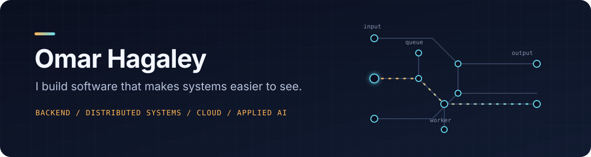

  

### hey, I'm Omar.

I'm a Computer Science & Software Engineering graduate from the University of Washington. I like the part of software where product ideas meet real systems: network activity, local discovery, queues, APIs, data, and the interfaces that make all of it understandable.

`currently exploring → backend systems · Rust desktop apps · cloud infrastructure · applied AI`

## things I've made

### 01 [Internet X-Ray](https://github.com/OmarHag/internet-x-ray)

`work in progress`

**See what your Mac is actually talking to.** A local-first desktop app that connects network sockets to the processes behind them, then sorts the noise into Internet, LAN, local, and listening traffic.

`Rust` `Tauri` `React` `TypeScript`

---

### 02 [SuperDrop](https://github.com/OmarHag/SuperDrop)

`work in progress`

**Nearby device discovery without an account or a cloud.** The Rust side advertises and finds computers over mDNS, validates their metadata, and gives the interface a small typed command boundary. File transfer is still the next step.

`Rust` `Tauri` `mDNS` `React`

---

### 03 [Faultline](https://github.com/OmarHag/Nextprod)

**A distributed system you are supposed to break.** Add a traffic spike or take a worker offline and watch the queue, retries, routing, latency, and recovery change together.

[open the lab ↗](https://nextprod-neon.vercel.app) · `Next.js` `React` `TypeScript`

---

### 04 [ExplainMyCode](https://github.com/OmarHag/explainmycode)

**Code explanations that meet the reader where they are.** My UW capstone shapes explanations around experience level and focus while the backend handles input limits, language detection, structured model output, persistence, and sessions.

`Next.js` `PostgreSQL` `Applied AI`

## a result that changed what I wanted to build

> My distributed-systems research documented a **20% reduction in processing time**. The interesting part wasn't only the number—it was finding the slow part, measuring it, and making the whole system easier to reason about.

## find me

Washington · open to backend, platform, cloud, and applied AI roles

[LinkedIn](https://www.linkedin.com/in/omar-hagaley-b46a04293) / [omarhag396@gmail.com](mailto:omarhag396@gmail.com)
